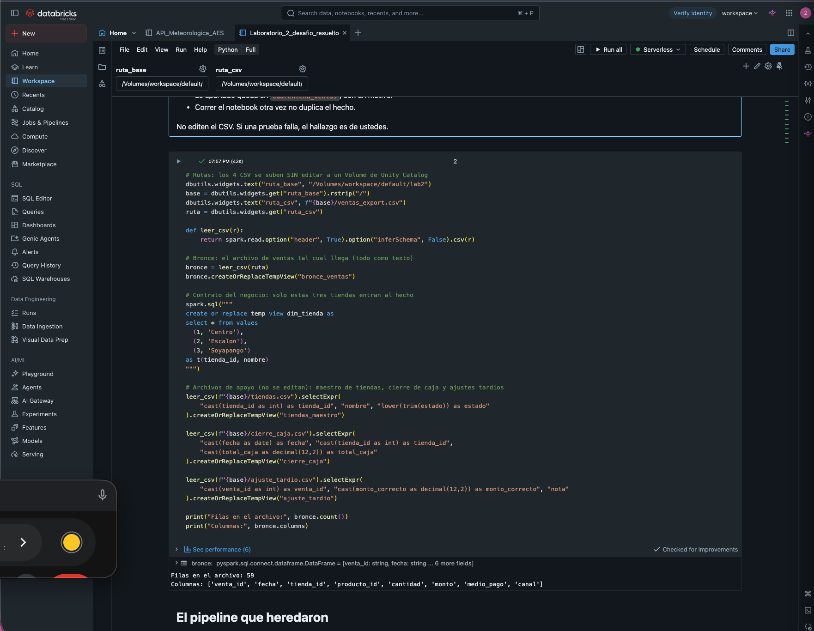
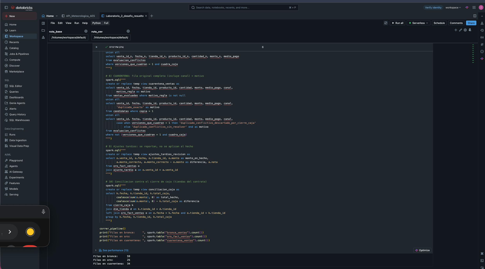
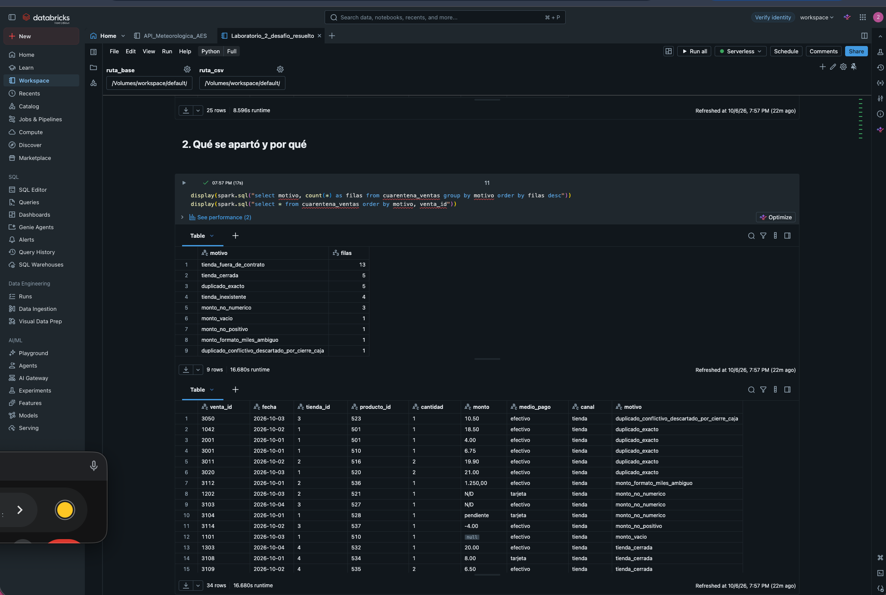
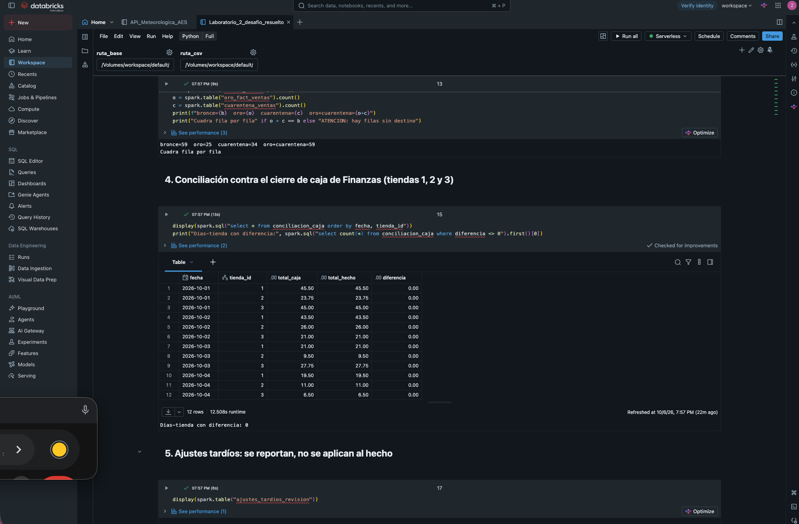
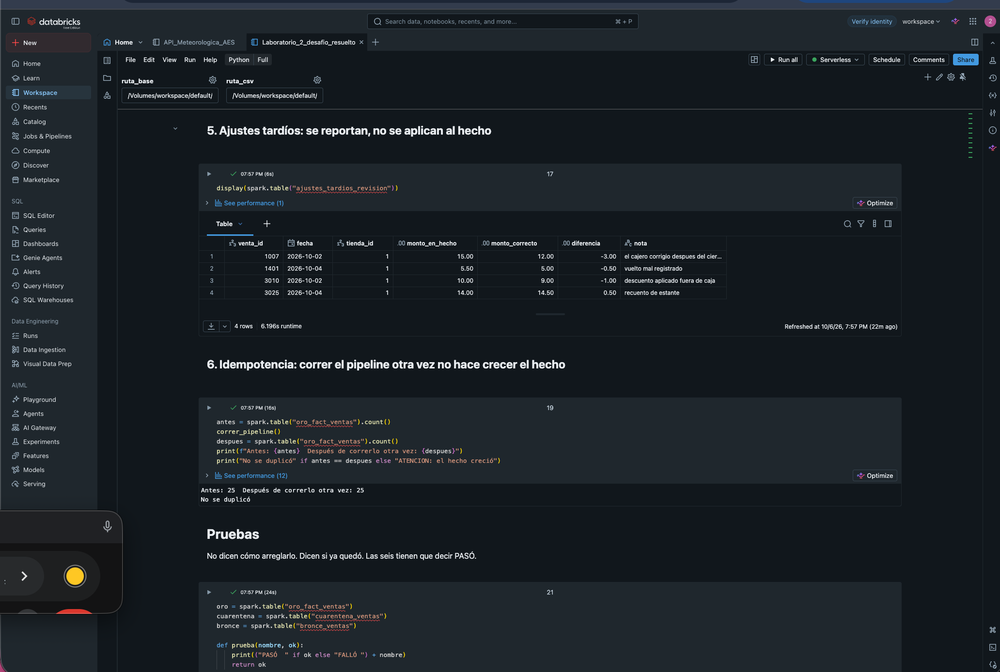
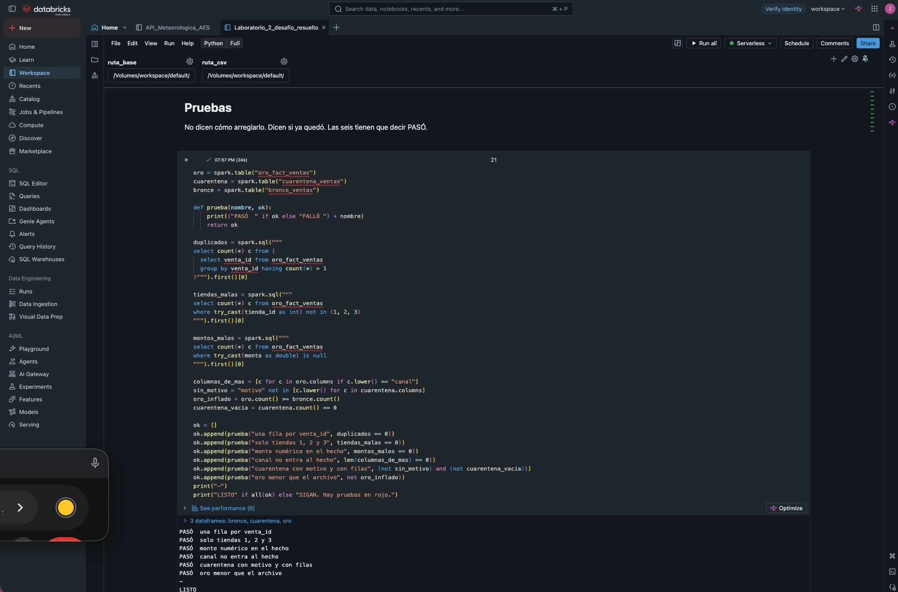

# Laboratorio 2 — El tablero no cuadra

**Asignatura:** Arquitectura de Datos en Entornos Digitales · UJMD
**Docente:** Ing. Jaime García
**Estudiante:** Sharon Ariel Gómez Cartagena — Carnet 202400545
**Plataforma:** Databricks Free Edition (Serverless)

## Problema

Un pipeline heredado cargaba el archivo de ventas completo al hecho, sin apartar nada, y duplicaba filas en cada ejecución. Finanzas reportaba que las ventas no cuadraban con la caja. El objetivo fue dejar `oro_fact_ventas` usable y documentar en `cuarentena_ventas` todo lo que se apartó, con su motivo.

## Estructura del repositorio

```
├── README.md                               ← este documento (evidencia y decisiones)
├── Laboratorio_2_desafio_resuelto.ipynb    ← notebook ejecutado en Databricks
├── datos/                                  ← los 4 CSV originales, sin editar
│   ├── ventas_export.csv
│   ├── tiendas.csv
│   ├── cierre_caja.csv
│   └── ajuste_tardio.csv
└── evidencias/                             ← capturas de la ejecución en Databricks
```

## Cómo ejecutarlo

1. Subir los 4 CSV, sin editar, a un Volume de Unity Catalog: `/Volumes/workspace/default/lab2/`.
2. Importar el notebook en Databricks y conectarlo a cómputo Serverless.
3. Ejecutar todas las celdas (**Run all**). El widget `ruta_base` permite cambiar la carpeta de los archivos.

## Reglas del negocio aplicadas

| Regla | Cómo se implementó |
|---|---|
| Una fila por `venta_id` | Los duplicados exactos se reducen a una copia. Los duplicados con datos distintos se resuelven con el cierre de caja. |
| Solo tiendas 1, 2 y 3 | Se valida contra `dim_tienda`. El motivo de rechazo se precisa con el maestro `tiendas.csv`. |
| `monto` numérico | Se acepta punto o coma decimal. Se aparta lo vacío, lo no numérico, lo no positivo y el formato con separador de miles. |
| Columna fuera de contrato | `canal` no entra al hecho: este se construye con una lista explícita de 7 columnas. |
| Cuarentena con motivo | Cada fila apartada conserva sus datos originales y un `motivo`. |
| Idempotencia | Todo se crea con `create or replace`: volver a ejecutar reemplaza el resultado, no lo acumula. |

## Resultados

| Tabla | Filas |
|---|---|
| `bronce_ventas` (archivo original) | 59 |
| `oro_fact_ventas` | 25 |
| `cuarentena_ventas` | 34 |
| oro + cuarentena | 59 ✔ (ninguna fila se pierde) |

### Qué se apartó y por qué

| Motivo | Filas | Explicación |
|---|---|---|
| `tienda_fuera_de_contrato` | 13 | Tiendas 5 y 6: abiertas, pero fuera del contrato (1, 2 y 3). |
| `tienda_cerrada` | 5 | Tiendas 4 y 7, marcadas como cerradas en el maestro. |
| `duplicado_exacto` | 5 | Copia repetida de las ventas 2001, 3001, 1042, 3011 y 3020. |
| `tienda_inexistente` | 4 | Tiendas 99, 88 y 77, que no existen en el maestro. |
| `monto_no_numerico` | 3 | Montos `N/D` y `pendiente`. |
| `monto_vacio` | 1 | Venta sin monto. |
| `monto_no_positivo` | 1 | Monto negativo (-4.00). |
| `monto_formato_miles_ambiguo` | 1 | `"1.250,00"`: el cierre de caja demuestra que esa venta no se cobró. |
| `duplicado_conflictivo_descartado_por_cierre_caja` | 1 | Versión de 10.50 de la venta 3050. |

### Conciliación con el cierre de caja

Para las tiendas 1, 2 y 3, la suma diaria de `oro_fact_ventas` coincide con `cierre_caja.csv` en los **12 días-tienda, con diferencia 0.00**. El tablero ya cuadra con Finanzas.

### Ajustes tardíos

Los 4 registros de `ajuste_tardio.csv` **no se aplicaron al hecho**. El cierre de caja cuadra con los montos originales, y las notas indican que los ajustes se hicieron después del cierre o fuera de caja. Aplicarlos rompería la conciliación. Quedan reportados en la vista `ajustes_tardios_revision` para que Finanzas los apruebe.

### Pruebas

Las seis pruebas del notebook dicen **PASÓ**, y una segunda ejecución del pipeline mantiene el hecho en 25 filas.

## Hallazgos para Finanzas

1. **Las tiendas 5 y 6 están abiertas y tienen cierre de caja**, pero el contrato del hecho las excluye. Si deben reportarse, hay que ampliar el contrato.
2. **La venta 3050 llegó con dos montos distintos.** El sistema de origen no garantiza una sola versión por venta.
3. **Hay 4 ajustes de caja posteriores al cierre** pendientes de aprobación.

## Evidencias

> Capturas de la ejecución en Databricks (carpeta `evidencias/`).

1. Carga de los archivos: filas y columnas de bronce
   
2. Pipeline ejecutado: filas en oro y en cuarentena
   
3. Cuarentena agrupada por motivo
   
4. Conciliación con el cierre de caja (diferencia 0)
   
5. Idempotencia: segunda ejecución sin crecimiento
   
6. Las seis pruebas en PASÓ
   

## Respuestas del desafío

Las respuestas a las cinco preguntas están en la última celda del notebook.
